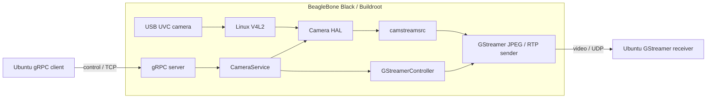

# Remote Video Monitoring

Remote Video Monitoring (RVM) lets an Ubuntu computer control and watch a USB camera attached to a BeagleBone Black (BBB). The operator boots the board, chooses its camera and destination, starts a viewer on Ubuntu, then configures, starts and stops one camera session. The board handles capture and sends video; Ubuntu displays it. This is an Embedded Linux engineering MVP, not a production surveillance product.

The control commands use gRPC. The video uses JPEG carried by RTP over UDP. The two paths are separate so a control reply cannot be mistaken for proof that Ubuntu received a frame.

## Why this project exists

A camera attached to a small board is useful only when an operator can configure it, see its video elsewhere, and stop it without leaving the device or process in an unsafe state. RVM demonstrates that complete path on a real Embedded Linux target. It also makes the engineering boundaries visible: Linux owns USB capture, a C HAL manages camera lifetime, GStreamer handles timed media, and gRPC carries control requests. A beginner can run the system; a developer can inspect the ownership and failure paths behind it.

## What is implemented

- A C11 Camera HAL with an opaque public API, dynamic backend loading, a V4L2 backend, and a simulated backend for tests.
- A C/GObject `camstreamsrc` source that copies camera frames into GStreamer memory and releases HAL frame tokens before publication.
- C++17 `CameraService` and `GStreamerController` for camera ownership, session state, and pipeline lifetime.
- A protobuf/gRPC control API for discovery, capabilities, Configure, Start, Stop, and Status. Video is sent separately through RTP/JPEG over UDP.
- A Buildroot external tree that packages the BBB server, runtime libraries, V4L2 backend, GStreamer plugin, dependencies, and a SysV init script.

The production camera path is **V4L2 backend → Camera HAL → camstreamsrc → GStreamer**. Diagnostic `v4l2-ctl` and `v4l2src` use are outside that path.

## What an operator does

On the BBB, the operator boots the Buildroot image, identifies the camera's Video Capture node, and configures the service for a trusted lab network. On Ubuntu, they start the RTP/JPEG receiver and use the client to query capabilities, Configure, Start, check Status, and Stop. A second Configure/Start/Stop cycle checks that resources were released for restart. The service reports its local state; the Ubuntu receiver must confirm decoded video independently.

## Technology at a glance

| Technology | Role here |
|---|---|
| Linux `uvcvideo` and V4L2 | Kernel camera support and userspace capture operations |
| C11 Camera HAL and backend SPI | Stable C boundary, opaque camera state, backend selection and frame tokens |
| GStreamer / C/GObject | Frame copy, caps/timestamps, JPEG encoding and RTP output |
| C++17 | Session, pipeline lifetime and coordinated cleanup |
| Protobuf / gRPC | Versioned remote control and status, separate from video |
| CMake / Buildroot | Host development and BBB cross-built firmware |

## Source layout

| Directory | Purpose |
|---|---|
| `libs/camera-hal/`, `backends/camera/` | Public C ABI, private Core/runtime, V4L2 and simulated implementations |
| `plugins/camstreamsrc/` | GStreamer source plugin using the public HAL |
| `libs/gstreamer-controller/`, `apps/camera-service/` | C++17 pipeline and camera-session owners |
| `apps/grpc-control/` | Protobuf contract, adapter, server, and Ubuntu client |
| `br2-external/` | BBB Buildroot configuration, application package, and startup files |
| `tests/` | Host regression and integration tests |

## Start here

Read [Getting started](docs/getting-started.md) for host prerequisites, build commands, firmware preparation, and the two-cycle camera check. The BBB configuration defaults to loopback-only gRPC and a local GStreamer sink; network mode requires explicit trusted-lab settings. There is no one-command installation.

| Guide | Question it answers |
|---|---|
| [System architecture](docs/system-architecture.md) | How do control and video travel through the system? |
| [Component design](docs/component-design.md) | Which module owns each interface and resource? |
| [Runtime lifecycle](docs/runtime-lifecycle.md) | What happens during Configure, Start, frames, Stop, and failure? |
| [Applied Embedded Linux](docs/applied-embedded-linux.md) | Why are V4L2, a C ABI, GStreamer, gRPC, and Buildroot used? |
| [Build and deployment](docs/build-and-deployment.md) | How are host and BBB artifacts produced and checked? |
| [Troubleshooting](docs/troubleshooting.md) | How are camera, plugin, control, and receiver failures isolated? |

The [M7 evidence record](docs/verification/m7-verification-report.md) separates owner-reported hardware results from unmeasured behavior. The [system contracts](docs/architecture/system-contracts.md) and [gRPC contract](apps/grpc-control/README.md) retain detailed API and ownership rules.

## Status and limits

The owner reported a BBB firmware boot, gRPC control, Ubuntu RTP/JPEG display, and two Configure → Start → Stop cycles using a Logitech C270 at configured YUYV 640×480, 15 FPS. BBB sender counters are **not** decoded receiver FPS; the detailed observations are in the [M7 evidence record](docs/verification/m7-verification-report.md). Long-run performance, stability, recovery, receiver FPS/loss/jitter, and the cause of observed C270 USB resets remain unverified. Plaintext gRPC and unauthenticated UDP are limited to a trusted lab; release source pinning, licensing, and third-party notices remain open. Raspberry Pi integration is future work and is not implemented.
