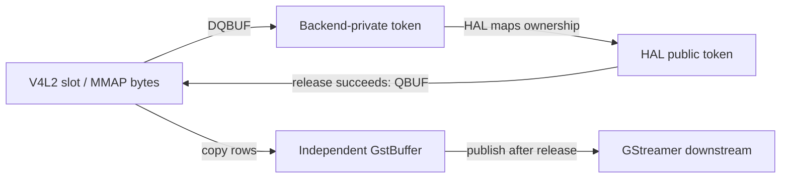

# Applied Embedded Linux in RVM

This guide explains the engineering ideas behind the working BBB-to-Ubuntu video path. It starts at the Linux device boundary and ends at the target image. Follow [system architecture](system-architecture.md) for the full picture, [component design](component-design.md) for exact module contracts, and [runtime lifecycle](runtime-lifecycle.md) for ordering. Code excerpts are identified as source excerpts; teaching sequences are labeled separately. None is a new API or a claim that every camera works.

## From USB hardware to a V4L2 userspace backend

An application does not usually send raw USB transactions to a webcam. Linux's `uvcvideo` kernel driver speaks the **USB Video Class (UVC)** device protocol and exposes a **Video4Linux2 (V4L2)** capture node. The kernel owns USB hardware and driver timing; the process owns a file descriptor (FD) for a selected `/dev/videoX` node. An `ioctl` is a device-specific request made through that FD. For example, `VIDIOC_QUERYCAP` asks whether the node supports video capture. This boundary lets RVM use a camera without implementing a USB driver. A UVC metadata node is not interchangeable with a Video Capture node.

The [V4L2 device code](../backends/camera/v4l2/src/v4l2_device.c) opens an operator-selected node and checks `VIDIOC_QUERYCAP`. The [configuration code](../backends/camera/v4l2/src/v4l2_config.c) enumerates pixel formats, frame sizes and intervals with `VIDIOC_ENUM_FMT`, `VIDIOC_ENUM_FRAMESIZES` and `VIDIOC_ENUM_FRAMEINTERVALS`. It requests YUYV format and a rational frame interval through `S_FMT` and `S_PARM`, then reads back the interval with `G_PARM`. A rational frame rate has numerator and denominator: `15/1` means 15 frames per second. The driver may return different active dimensions or timing. RVM validates those values before calling the camera Configured. A requested 15 FPS is an instruction to the driver; only frames counted at a named point over a measured interval establish delivered FPS.

One checked dequeue in [`v4l2_acquire_frame()`](../backends/camera/v4l2/src/v4l2_stream.c) starts with this real source excerpt:

```c
struct v4l2_buffer buffer = {0};
buffer.type = V4L2_BUF_TYPE_VIDEO_CAPTURE;
buffer.memory = V4L2_MEMORY_MMAP;
if (v4l2_ioctl_device(camera->fd, VIDIOC_DQBUF, &buffer) == -1)
{
    const int error_number = errno;
    if (error_number == EAGAIN)
    {
        return CAMSTREAM_CAMERA_STATUS_TIMEOUT;
    }
    return v4l2_set_errno_error(camera, "VIDIOC_DQBUF", error_number);
}
```

This code captures `errno` immediately and maps `EAGAIN` to a timeout. A returned buffer is then checked for a valid index, payload length and ownership before its bytes are exposed. An `ioctl` return of `-1` is a failure, not an empty image. This example is backend code, not a command to run on BBB.

Streaming uses a queue shared across kernel and process boundaries. [`v4l2_stream.c`](../backends/camera/v4l2/src/v4l2_stream.c) requests buffers, queries their offsets, and uses **memory mapping (`mmap`)** to give userspace an address for driver-managed storage. It queues each slot with `VIDIOC_QBUF`. After `VIDIOC_STREAMON`, bounded `poll` waits for readiness and `VIDIOC_DQBUF` transfers one buffer to userspace. Returning it with `QBUF` lets the driver reuse that storage.

The buffer index identifies a slot; it is not a copy of the image. If `bytesused` exceeds the mapped length, the backend cannot safely publish the plane. Stop uses `STREAMOFF` and checked unmap/release. A partially mapped queue needs partial cleanup; pretending every slot was mapped would unmap invalid addresses. A recoverable `V4L2_BUF_FLAG_ERROR` frame is discarded and requeued, but a failed requeue is a real error. USB resets and frame warnings are observations, not proof of one root cause.

## Why a C HAL and a backend SPI exist

A **hardware abstraction layer (HAL)** gives callers one camera vocabulary even when the device implementation changes. RVM's [public C11 header](../libs/camera-hal/include/camstream/camera/camera_hal.h) contains status codes, version/size-checked configuration and frame structures, and an opaque `camstream_camera*`. The header deliberately contains no Linux FD, V4L2 buffer, GStreamer object or C++ class. Its **application binary interface (ABI)** fixes the functions and data layout a compiled caller can use. C is directly callable from both the C/GObject source element and C++17 service.

The actual public declaration is short:

```c
typedef struct camstream_camera camstream_camera;
```

This tells callers a handle exists without exposing its fields. The private [Core structure](../libs/camera-hal/src/camera_core.c) holds state, a backend instance, outstanding frame mappings and diagnostics. External code therefore cannot change a camera state by editing a public field. Public structures still need the correct `abi_version` and `struct_size` before a HAL call; an uninitialized header can make the call fail before any backend work. These fields also let the HAL validate a caller's expected layout instead of guessing its memory size.

The HAL facade, Core and Backend Runtime have different jobs. The [facade](../libs/camera-hal/src/camera_hal.c) exports the stable `camstream_camera_*` names. Core validates state and owns public frame tokens. The [runtime](../libs/camera-hal/src/camera_backend_runtime.c) owns one module handle, a validated callback table and reference/reservation counts. Keeping them separate means the ABI entry point does not become a V4L2 implementation, and the module loader does not become the owner of per-camera frame state.

The backend **service provider interface (SPI)** is a C operation table: a structure of function pointers for create, open, configure, acquire, release, stop and other operations. The [V4L2 constructor](../backends/camera/v4l2/src/camera_backend_v4l2.c) assigns the following real table entries; the [simulated backend](../backends/camera/simulated/src/camera_backend_simulated.c) fills the same SPI with hardware-independent functions:

```c
.camera_acquire_frame = v4l2_acquire_frame,
.camera_release_frame = v4l2_release_frame,
```

Core invokes the selected callback without an `if V4L2 else simulated` branch at every operation. The simulated backend exercises the same interface in tests; it is not a second production camera owner. [Component design](component-design.md#backend-runtime-and-spi-v2) traces one call across this table.

Dynamic loading adds a lifetime problem: a callback address becomes invalid after its shared library is unloaded. The **Executable and Linkable Format (ELF)** constructor runs when Runtime calls `dlopen`. In RVM it claims a HAL-owned SPI v2 staging slot and writes addresses only; it does not touch `/dev/videoX`. Runtime checks version, exact table sizes, name and required callbacks before publishing the binding.

Consider a second thread requesting unload while backend `create` is running. Runtime takes a **create reservation** before invoking the callback, so final unload cannot invalidate code still executing. It never holds its mutex while invoking `dlopen`, `dlclose` or callbacks because a constructor can re-enter Runtime. The service destroys the last camera **before** releasing the final module client reference. A module that fails binding validation is not a usable backend. The exact reservation rules live in the [system contract](architecture/system-contracts.md#43-module-references-and-loader-transaction--preserved-baseline).

## Buffers, tokens and GStreamer memory

Several identifiers refer to one frame, but they do not mean the same thing. A V4L2 **buffer index** selects a kernel queue slot. The backend assigns a **private token** to an outstanding dequeue. [HAL Core](../libs/camera-hal/src/camera_core.c) maps that private token to a process-unique, nonzero **public token** returned to `camstreamsrc`. This is like checking out a library book: the shelf position, the library's internal record and your checkout receipt are related, but they are different identities. A public token belongs to one HAL camera; another camera cannot release it even if a private number happens to match.



As a concrete example, YUYV 640×480 has **1,280 active bytes per row** and 614,400 active image bytes. A driver may report a larger stride, so the source copies only those 1,280 useful bytes from each row into its tightly packed output. The numbers describe this example, not a fixed buffer size in the HAL. The backend still owns the original mapped slot; HAL Core owns the public-token mapping; the source temporarily holds its token value; GStreamer owns the copy after publication.

The buffer's bytes remain backend-owned. The public HAL [frame plane](../libs/camera-hal/include/camstream/camera/camera_hal.h) exposes a **borrowed** pointer, `bytes_used`, `allocation_size` and `stride` only until successful release. Borrowing means the caller may read the bytes now but must not free them or use them after return. Release reaches backend `QBUF`, after which the driver may overwrite that MMAP storage. Core removes the public-token mapping only when backend release succeeds. On a failed release, losing the mapping would lose the way to retry or diagnose ownership. A token cannot be silently discarded after an error.

GStreamer has a different ownership model. A **GStreamer element** is one stage in a media graph; pads are its input/output connection points. **Caps** declare the format that connected pads agree to exchange. For HAL YUYV bytes, `camstreamsrc` emits GStreamer `video/x-raw,format=YUY2` caps. A `GstBuffer` carries one payload and metadata, and its reference-counted memory may outlive the source callback.

[`camstream_src_create()`](../plugins/camstreamsrc/src/camstreamsrc.c) validates the plane, allocates a `GstBuffer`, copies each row, then **successfully releases the HAL token before publishing**. The final transfer to GStreamer is visible in this real source excerpt, reached only after release and final flushing checks:

```c
*published = output;
output = NULL;
```

Setting `output` to NULL prevents the source's cleanup path from unrefing a buffer it has handed downstream. The JPEG encoder reads the independent copy, so a later kernel requeue cannot overwrite its input. Copying costs CPU and memory bandwidth but gives this design a clear lifetime boundary. Wrapping MMAP memory would need a separately approved downstream lease and serialized release; it is not implemented. If allocation fails, no token is published; if HAL release fails, the source retains a pending token and reports an error instead of publishing the copy.

GStreamer also tracks time and state. **Presentation timestamp (PTS)** tells downstream when to present a buffer. The source approximates PTS with pipeline running time near acquisition and derives nominal duration from active rational FPS. Neither is a verified camera exposure timestamp. A `DISCONT` flag marks the first frame or a sequence gap, not a lost UDP packet. The [controller](../libs/gstreamer-controller/src/gstreamer_controller.cpp) owns pipeline, bus and element references and waits for the required state. Reaching PLAYING is not proof that Ubuntu decoded a frame. A later bus error can move the service to Faulted.

## C++17 lifetime, locks and control

C++17 is used where long-lived application objects coordinate resources rather than issue device ioctls. **Resource Acquisition Is Initialization (RAII)** ties a resource to an object's lifetime: a destructor can release it when the object leaves scope. For example, [`server_main.cpp`](../apps/grpc-control/src/server_main.cpp) stores the started gRPC server in a `std::unique_ptr<grpc::Server>`. That smart pointer owns the server object; it does not own camera frames.

[`CameraService`](../apps/camera-service/src/camera_service.cpp) owns the HAL camera and module client reference; [`GStreamerController`](../libs/gstreamer-controller/src/gstreamer_controller.cpp) owns the GStreamer graph. RAII helps release these resources, but a destructor cannot make the wrong order safe. Controller first stops new source work, flushes and waits for callbacks, retries any pending token release and unbinds the borrowed camera. Only then may Service stop/close/destroy HAL and unload its backend. If quiescence fails, Service retains ownership in Faulted rather than freeing a camera still used by a callback.

Threads make that order necessary. gRPC handlers can call Service while GStreamer runs its source callback. Service's operation mutex serializes control operations; source `in_flight`/stop intent coordinates capture with Controller Stop. The HAL contract still requires one caller at a time per instance. Runtime's mutex protects module transitions, not every frame operation. Holding that mutex across a backend callback or loader call could deadlock on re-entry. A bounded HAL wait lets flushing finish without closing an FD underneath an active poll. A useful failure question is: “Could a callback still be reading the borrowed frame when Stop destroys its camera?” If yes, teardown must wait or retain ownership, not free the camera.

[Protocol Buffers (Protobuf)](../apps/grpc-control/proto/camera_control.proto) define typed control messages and stable field tags. **gRPC** transports those request/response messages to BBB. The [adapter](../apps/grpc-control/src/grpc_adapter.cpp) validates logical `camera0`, mode values and `expected_generation` on each mutating request, then translates Service results to gRPC status. Generation is a version of the service state **within one server process**. For example, if Configure commits but its reply is lost, the client must call `GetStatus` before retrying; a network timeout does not undo the camera operation. No raw video frame travels in this channel.

## Why gRPC and RTP/UDP are separate

Control messages are small and need typed requests, validation, errors and a response. A continuous video stream has different timing and buffering needs. In network mode the controller uses a bounded queue, `jpegenc`, `rtpjpegpay` and `udpsink`; Ubuntu receives it with its own GStreamer pipeline. **Real-time Transport Protocol (RTP)** supplies media packet metadata, carried here over **User Datagram Protocol (UDP)**. UDP does not acknowledge delivery, so a successful `StartStream` says the BBB pipeline started, not that the remote display showed video. The BBB `local_pipeline_frames` counter is before RTP packetization. To estimate decoded receiver FPS, count successfully decoded frames on Ubuntu over a measured interval; [Getting started](getting-started.md#3-start-the-ubuntu-receiver) provides the receiver procedure.

The operator selects the numeric IPv4 media destination and UDP port at server startup, not through an RPC. The server defaults to loopback-only plaintext gRPC and local `fakesink` mode. Remote plaintext control and unauthenticated UDP are appropriate only for an explicitly trusted lab. Adding production authentication, encryption or recovery requires a separate design.

## Buildroot and cross-compilation

An Ubuntu compiler build produces Ubuntu binaries useful for development tests; those binaries cannot run on BBB's ARM processor. **Cross-compilation** runs the compiler on Ubuntu but emits ARM code and links it against the target's libraries. **Buildroot** assembles that toolchain, kernel, root filesystem, dependencies and bootable image from one configuration. RVM's [external tree](../br2-external/) adds the board settings and package without copying application code into Buildroot itself.

The [RVM package](../br2-external/package/remote-video-monitoring/remote-video-monitoring.mk) uses Buildroot host tools and target sysroot to compile this checkout. Its real package settings include:

```make
REMOTE_VIDEO_MONITORING_SITE_METHOD = local
REMOTE_VIDEO_MONITORING_INSTALL_TARGET_OPTS = --component Runtime
```

`local` means Buildroot copies the **current working tree**. `--component Runtime` installs the server, HAL, V4L2 backend and GStreamer plugin, not host tests or the Ubuntu client. The package also installs the config and SysV startup script. `target/` is staging input; `images/sdcard.img` is the image the owner can flash manually. On the booted BBB, the runtime linker still needs the ARM shared libraries and GStreamer must discover its plugin and media elements. A missing target library or plugin can therefore break startup even when cross-compilation succeeded.

A host PASS is not an ARM build PASS; an ARM **ELF binary** inspection is not a BBB runtime PASS; a BBB sender count is not an Ubuntu decoded-frame measurement. A local-source package is not an immutable release revision. [Build and deployment](build-and-deployment.md) gives the owner commands and safety boundary, and the [M7 evidence record](verification/m7-verification-report.md) distinguishes previously reported hardware functionality from unmeasured stability.
