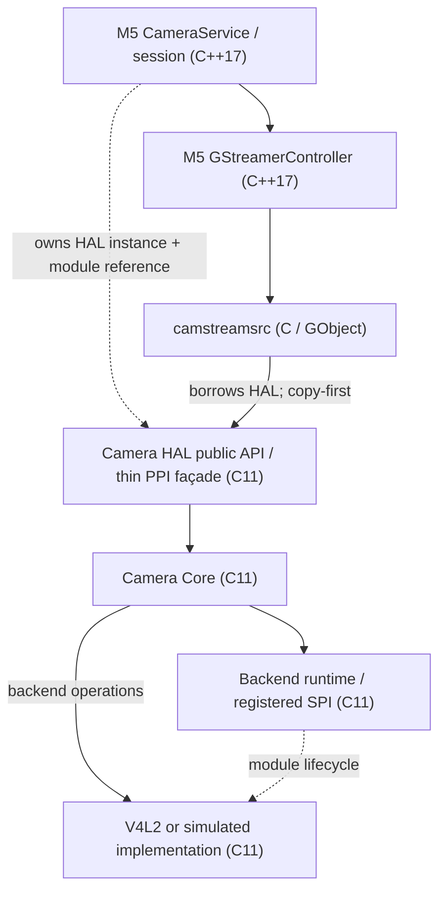

# RVM Architecture Decision — Samsung-Inspired Layering (V3 / R1-B)

> Project: Remote Video Monitoring (RVM), BeagleBone Black + Buildroot + Logitech C270  
> Decision: **R1-B SOURCE SPLIT IMPLEMENTED; LOCAL VERIFICATION PASS; OWNER REVIEW PENDING**  
> Checkpoint: **R1-B, full internal source-organization refactor; before M5**  
> Companion: [`../engineering/samsung-style-coding-rules.md`](../engineering/samsung-style-coding-rules.md)  
> Evidence baseline: owner-reported M4-B BBB YUYV 640×480 @ 15/1, two 30-frame sessions PASS; USB resets unresolved.

## 1. Decision and source of truth

RVM adopts the clear, layered **public interface (PPI intent) → Core → implementation** organization and disciplined naming, diagnostics, ownership and cleanup observed in the user's Samsung HDMI/Broadcast work examples. This is an **RVM-specific implementation of that style**, not a claim that all Samsung codebases share a universal layout. Do not copy proprietary examples into RVM.

Unlike the narrower R1 documentation-only adoption, **R1-B requires a meaningful production-source refactor** of the Camera HAL and V4L2 backend into the source files named in §3. Keep binaries, external interfaces, behavior and real ownership unchanged. Do not add an extra PPI shared library, extra dispatch table, second capture path or architecture framework.

Authority, highest first: (1) current explicit owner instructions and the protected ABI/ownership invariants in `docs/architecture/system-contracts.md` §§4–5; (2) `AGENTS.md` and actual public headers; (3) this R1-B organization decision and the companion coding rules; (4) domain guidelines and approved M3/M4 behavior; (5) historical examples. For an actual conflict affecting a protected contract, stop and report it. Historical M0-B wording about the *owner placement* is superseded by the later owner decision: **CameraService/session owns the HAL; `camstreamsrc` borrows it**. This does not relax the original HAL serialization/lifetime contract.

**R1-B is a refactor, not M5.** At this checkpoint, implement no C++ service/controller, RPC server, streaming transport, automatic reconnect or board-specific feature. CODEX works on local Ubuntu only. The owner alone deploys/tests on BBB.

## 2. Layers, dependency and resource ownership



The backend runtime is a loader/registry, not a replacement for HAL frame-processing Core. Each camera instance selects exactly one backend. V4L2 userspace code calls kernel V4L2; `camstreamsrc` never directly calls `ioctl`, owns no V4L2 FD and does not create/destroy the HAL camera. Tests may substitute the simulated or fault backend.

| Layer | Owns | Must not own |
|---|---|---|
| C11 public HAL façade | Existing exported C entry points, minimal contract boundary checks, delegation to Core/runtime | Independent state machine, public-token store, V4L2 operations |
| C11 Camera Core | Opaque camera state, version/argument validation, public-token generator and mapping, error propagation, cleanup/rollback, backend-operation ordering | Loader mutex implementation, Linux V4L2 ioctls, Gst objects |
| C11 runtime | Module load/unload, registration, ABI negotiation, references, create reservations/live-instance transactions | Per-camera acquisition or device FD |
| C11 V4L2 backend adapter | Existing SPI operation table and backend registration; maps SPI calls to private helpers | A second HAL API, independent lifetime ownership |
| C11 V4L2 device/config/stream | Device instance create/destroy, FD/error/low-level I/O; enumeration/active negotiation; REQBUFS/MMAP/poll/queue/capture respectively | HAL public-token semantics, GStreamer/RPC |
| C/GObject `camstreamsrc` | GST source/metadata, bounded HAL-frame copy, release-before-publish | HAL instance/module ownership or backend I/O |
| C++17 M5 service/controller, not part of R1-B | Service owns HAL session; controller owns pipeline/bus/Stop | Duplicate capture path or C ABI changes |

There is **one** `libcamstream-camera-hal.so` and **one** V4L2 backend module `.so`, with their existing targets, exported ABI and installation paths.

## 3. Required source layout and boundaries

Use the following paths as the **R1-B target**, not an optional suggestion. Existing filenames not listed stay in place unless an exact test/build adjustment requires otherwise.

```text
libs/camera-hal/
  include/camstream/camera/camera_hal.h       # existing app-facing public C ABI — retain
  include/camstream/camera/camera_backend.h   # existing backend SPI — retain
  src/camera_hal.c                            # thin exported HAL/PPI entry points
  src/camera_core.h                           # new PRIVATE camera Core interface/types
  src/camera_core.c                           # new camera state/token/rollback/Core logic
  src/camera_backend_runtime.h                # existing PRIVATE runtime interface
  src/camera_backend_runtime.c                # existing loader/refcounts/reservations

backends/camera/v4l2/
  src/camera_backend_v4l2.c                   # thin SPI adapter/ops table/registration
  src/v4l2_internal.h                         # new PRIVATE instance, buffer types, helpers
  src/v4l2_device.c                           # new instance create/destroy, FD, I/O shim, error/device lifetime
  src/v4l2_config.c                           # new enumerate, validate/confirm configuration
  src/v4l2_stream.c                           # new REQBUFS/MMAP, queue, wait, stream, frame tokens

backends/camera/simulated/                    # retain, apply naming checks only if needed
libs/common/                                  # existing shared logging — retain
plugins/camstreamsrc/                         # existing source, binding header, tests — retain
tests/camera-hal/                             # update fake V4L2 target for all moved .c files
```

**Hard boundaries:**

1. `camera_hal.c` contains **only** public `camstream_camera_*`/`camstream_camera_hal_*` entry points, their essential checks and delegations. All camera object layout, token map and state-machine logic must move into `camera_core.c/.h`. Keep public signatures and behavior byte-for-byte compatible at the boundary; use short, descriptive private `camera_core_*` functions.
2. `camera_core.c` alone owns the private `struct camstream_camera`, the atomic process-lifetime public-token allocator and failed-release accounting. The façade must not duplicate Core state/validation. The runtime retains its current module-ref and reservation semantics.
3. `camera_backend_v4l2.c` owns the existing SPI registration and operation table; exported/registered operation signatures remain unchanged. Split implementation according to actual responsibility: `v4l2_device.c` FD and syscall test seam/error; `v4l2_config.c` discovery, `S_FMT`, `S_PARM/G_PARM` and active configuration; `v4l2_stream.c` buffer management, poll/queue/dequeue and stream transitions. Shared per-instance state resides in `v4l2_internal.h`, **not** an installed public header.
4. Move existing code and preserve call order, `errno`, return values and rollback. Never create duplicate owners for the same FD, mapping or state. Retain real work in each helper; avoid new generic dispatcher layers or one-helper-per-line fragmentation.
5. All production and V4L2 fake-test targets must compile/link the same set of moved production source units. Preserve `CAMSTREAM_V4L2_TEST_IO` interposition across **every** syscall path (open, ioctl, poll, close, mmap, munmap) through the existing test seam; no bypass to a real camera in fault tests.
6. Only private internal symbols may be new. Check shared-library dynamic symbols for accidental exports; do not use blanket hidden visibility if it would hide the existing C ABI, SPI registration or plugin entry points.
7. Do not rearrange the `camstreamsrc` capture implementation solely for visual symmetry. Its C/GObject lifecycle is an intentionally different layer with a distinct API.

## 4. Protected ABI and functional invariants

The refactor is acceptable **only if all of these remain true**:

- Preserve all `camstream_camera_*` public function signatures, status numeric values, ABI versions, struct/operation-table layout, minimum `struct_size` acceptance and existing exported symbols; no new mandatory SPI field. Preserve the loaded module registration contract.
- Retain process-wide unique, nonzero HAL public tokens independent of private backend tokens. The atomic allocator never resets after destroy/reload and never wraps after exhaustion. Reject foreign, duplicate and stale tokens according to the existing contract.
- Retain public-token mappings until successful normal release. A failed validation rollback that also fails release retains the pending-cleanup backend token. Final `destroy` remains **best-effort**, not an infinite wait or a fabricated successful release.
- Preserve the exact module reference semantics: non-final unload may decrement a client reference while an instance exists; final unload refuses active instances/create reservations without consuming the final reference; partial create is cleaned **before** canceling its reservation. Do not hold runtime mutex across backend callbacks or dynamic loader calls.
- Backend registration constructor registers only; no `open`/`ioctl` in constructors. Private callback addresses must not outlive final unload.
- Preserve V4L2 enumeration, requested/active FPS behavior, exact captured buffer byte/stride validation, MMAP/QBUF/DQBUF/STREAMON/OFF ordering, operation-specific bounded waits/retries, injected failure/cleanup behavior and the existing single-ioctl shim (no blanket retry wrapper).
- Preserve the M4 data path: bounded wait → acquire → validate frame/planes/stride → row-copy into independent YUY2 GstBuffer → **successful HAL token release** → publish. Failed release blocks publication, retains cleanup ownership and requires safe teardown. Caps reflect confirmed active YUYV+FPS; PTS uses pipeline running-time and nominal duration; sequence gaps/first frame mark DISCONT.
- The service/session (in M5) is sole HAL and module-reference lifetime owner. The plugin borrows it. All calls on one HAL instance are serialized across source and Stop/cleanup; GStreamer NULL/quiescence must precede HAL destruction and final module unload. R1-B adds **no** new HAL locking policy.

## 5. Platform, checkpoint and evidence boundaries

R1-B remains limited to local source refactor, CMake/test wiring, narrow documentation and regressions. It does not resolve camera identity selection, M5 concurrent service policy, M6 gRPC or M7 codec/transport. Do not migrate unrelated C++/kernel reference code or duplicate the pipeline.

**Known hardware issue, not a refactor failure:** `STAGE7-USB-01` — C270 behind a bus-powered hub shared with Wi-Fi has shown recoverable frame errors and USB/MUSB resets. The owner-reported M4-B and post-R1-B 2×30 valid frames at 15 FPS are evidence of functional smoke passes, not sustained reliability or root-cause proof. **M5 BBB: NOT RUN.**

R1-B exit evidence:

| Gate | Required result |
|---|---|
| Structure | Required façade/Core and V4L2 device/config/stream files exist with meaningful responsibility mapping; old monolith logic is actually moved |
| ABI | Compare baseline vs R1-B public HAL headers/status/SPI struct layout, exported symbols and linkage on host and ARM; no accidental new externally visible contract |
| Host | `-Werror` build, relevant V4L2 fake-injection, HAL runtime/fault, simulated and M4 plugin/session tests; full CTest and plugin discovery |
| Sanitizers | Relevant ASan/UBSan tests; disclose `detect_leaks=0` if used; pre-existing GLib/GStreamer 16 KiB LSan report is not a leak-free pass |
| ARM | Buildroot toolchain `-Werror`, artifact ABI/ELF/NEEDED and unchanged install paths; do not infer BBB runtime success |
| Hygiene | clang-format-14, `git diff --check`, source/test target inventory and updated docs; report any skipped/unavailable gate |

**Execution authority:** CODEX may modify local Ubuntu source/test/CMake/docs for this **R1-B** checkpoint after its preflight, but must not connect to BBB, run SSH/SCP/deploy, flash hardware, commit, push or create M5 features. End with `APPROVED` / `CHANGES REQUIRED` / `BLOCKED` plus exact evidence and owner-run BBB commands if needed. The next checkpoint is M5 only after owner review and any required BBB validation.

## 6. Migration from R1

The previous R1 edited interface comments and documentation but left implementation `.c` and targets unchanged. This V3 document **supersedes the prior optional-source-split language** only for R1-B. The required HAL and V4L2 source split is now present and locally verified. The owner subsequently reported a post-R1-B BBB functional smoke PASS; no M5 BBB result is claimed.

The repository's blanket `/docs/` ignore rule currently hides these decision files from normal Git status/diff. They remain authoritative local input for CODEX; the owner must explicitly choose to track them at Git review time (for example `git add -f` for the two exact paths). Do not delete the docs, the `.gitignore` or the pre-existing source files in advance of the verified refactor.
