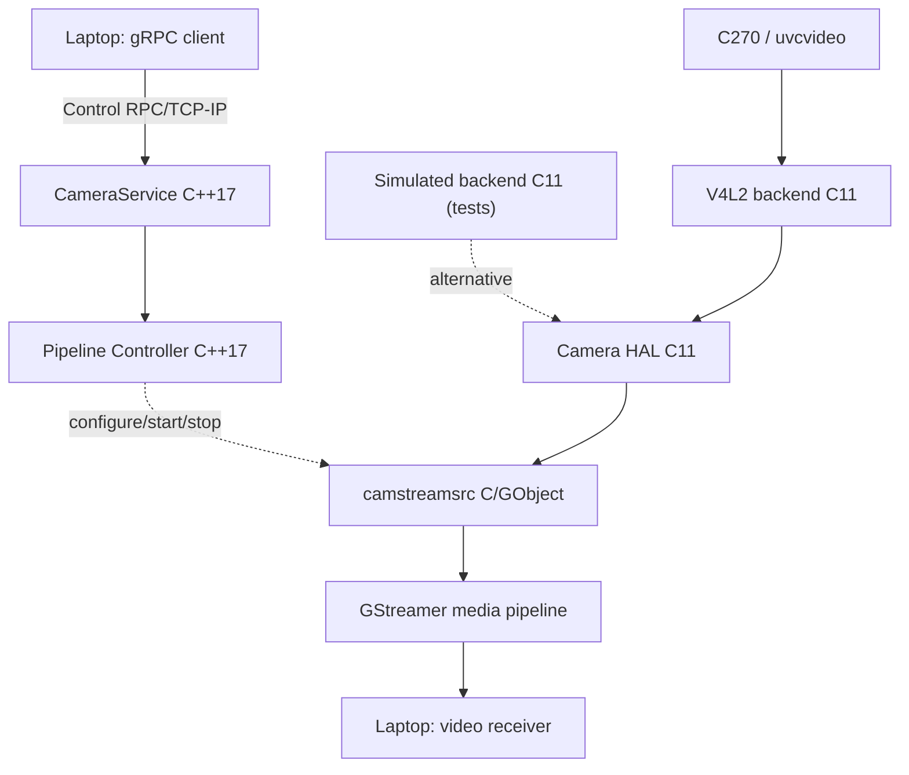

# System Architecture & Contract Baseline — Remote Video Monitoring

**Title:** Design and Implementation of a Remote Video Monitoring System  
**Platform:** BeagleBone Black + Logitech C270 + Buildroot/Linux  
**Document state:** Engineering contract reference. M0-B proposals and pending wording below record their historical state. The later M4 decision resolved HAL owner placement: CameraService/session owns the HAL instance and backend module client reference, GStreamerController owns pipeline state/bus/coordinated teardown, and `camstreamsrc` borrows HAL access. Other deferred decisions remain deferred. Historical approval/provenance is recorded in the migration baseline and source evidence.

## 1. Product first — giá trị thực tế

Thiết bị BBB lấy video từ camera USB đặt tại phòng lab/khu vực máy móc, truyền video tới laptop cùng mạng LAN và nhận lệnh điều khiển từ xa. Người vận hành có thể:

1. Liệt kê camera/configuration thực sự có.
2. Cấu hình format/resolution/frame interval theo contract được duyệt.
3. Start/Stop streaming qua gRPC.
4. Xem live video tại laptop qua GStreamer receiver.
5. Query health/status và phát hiện device loss, lỗi pipeline hoặc camera timeout.

**Proposed MVP limits — M0-B confirmation required:** một webcam, một stream active, một BBB và một laptop receiver. Không tự thêm AI, recording, browser dashboard, PTZ, cloud platform hay internet-facing service. Nâng cấp đa camera/client cần requirement riêng.

## 2. Kiến trúc không duplicate

- **Control plane:** gRPC Start/Stop/Configure/Status và state policy.
- **Data plane:** device frames → V4L2 backend → HAL → GStreamer/network media.
- **Tương tác:** Control plane thay đổi lifecycle/state của data plane; video payload không đi qua gRPC.
- **Production** chỉ có 1 capture path. Diagnostic `v4l2src` không chạy đồng thời trên cùng camera. Simulated backend **thay thế** V4L2 trong tests, không là camera thật thứ hai.

## 3. Responsibility & dependency boundaries

| Module | Owns | Must not own/depend on |
|---|---|---|
 Kernel/uvcvideo | USB/device/V4L2 kernel plumbing | Application RPC policy |
 V4L2 backend C11 | `device_fd`, ioctl, format/buffer/stream lifecycle, backend error | GStreamer/gRPC |
 Simulated backend C11 | Fake frame descriptors/payloads, deterministic test lifecycle | Physical camera |
 HAL C11 | C ABI, backend binding/loading, owned opaque camera instances, public token mapping, module lifetime | GStreamer/GStreamer symbols, gRPC/C++ STL |
 `camstreamsrc` C/GObject | Borrowed HAL access, caps, copy-first GstBuffer/metadata/frame release bridge | HAL instance/module reference; direct device open/ioctl |
 Controller C++17 | GStreamer pipeline state, bus and coordinated teardown | Direct backend fd/queue; HAL instance/module reference |
 CameraService C++17 | HAL instance and backend module client reference, authoritative session state, orchestration, RPC policy | Per-frame V4L2 mechanics |
 gRPC adapter | Translate remote request/result, auth/deadline/status mapping | Own camera instance independently |
 Receiver | Decode/display video on laptop | Direct HAL/BBB device access |

Dependency arrow should generally point downward: gRPC adapter → service → controller/plugin → HAL → backend → kernel. HAL must build/test without GStreamer and RPC. Backend must be usable/testable without service. Avoid cyclic libraries and hidden singleton side channels.

Approval classes: architecture/language and preserved ABI/ownership/concurrency invariants (§4–5) are fixed. Copy-first and the M4 HAL owner placement above are approved. §6 retains the historical M0-B proposals; remaining integration mechanisms are not approved merely because they appear there.

## 4. Selected baseline and protected HAL invariants

The selected legacy revision, exclusions and migration approval scope are maintained only in [migration baseline](../development/migration-baseline.md). This contract owns the protected behavior below, not milestone status. Recheck source identity before any separately authorized migration.

Protected invariants:

- Camera HAL public C ABI and `camstream_camera_status_t` ABI.
- Backend operation-table contract and opaque `camstream_camera_instance*` ownership. R2 migrates the backend-only
  registration SPI from v1 to v2 under the later explicit owner decision; it does not change the public HAL ABI.
- Per-instance backend state; HAL public vs backend internal frame token model.
- C-compatible status/error codes and exception policy in §4.1.
- Backend ELF constructor does **binding injection only**, no device I/O (R2 SPI v2); historical v1 used registration.
- Destroy instance **before** backend module unload.
- Maintain create/unload reservation until backend create/destroy transaction complete.
- Do **not** hold runtime mutex across backend callbacks.
- Preserve committed Phase-1 source open/capability/configuration enumeration semantics; this is not a HAL camera-list API or a new runtime PASS.
- Avoid unrelated HAL/runtime/test refactors during focused checkpoints.

### 4.1 ABI and exception policy — preserved baseline

The application-facing public C ABI retains signatures, field order/types, status representation and opaque handles.
Historical M2/R1-B text required backend SPI v1 parity. The later owner-approved R2 constructor push-binding design is
an explicit exception for the **backend-only SPI**: v2 replaces descriptor registration with HAL-owned staging and
operations, while preserving callback signatures and opaque backend instances. Old v1 modules must fail to load rather
than being interpreted as v2. SPI v2 uses fixed HAL-owned slots and exact size checks; extensions require a new hook.
Preserve minimum `struct_size` acceptance for unchanged public v1 structures; do not invent
reserved-field rejection. No private mutex or C++ type enters the public ABI. Binary compatibility verification belongs
to [verification §3.1](../engineering/verification-gates.md#31-c11-hal-coreruntime), separately for host and ARM.

C++ callbacks must contain their own exceptions and preserve declared signatures/status behavior; void cleanup callbacks remain void and nonthrowing. Pure C11 HAL/runtime/backends require no new C++ bridge to catch callbacks that violate this contract. Retaining defensive C++ catch code is not a requirement to retain C++ runtime dependencies in the C port.

### 4.2 Frame tokens — preserved baseline

- Public HAL tokens are process-wide unique and nonzero. They belong to a separate identity/ownership domain from backend-private tokens; numeric values may coincide. One camera cannot release another camera's public token even if private values match.
- The public allocator is process-lifetime state. It does not reset on camera destruction or backend unload/reload. After issuing `UINT64_MAX`, its zero/exhausted sentinel remains exhausted; it must not wrap and reuse tokens.
- Preserve the existing allocation-failure status/cleanup, mapping order, stale/duplicate validation and distinction between pending cleanup and ownership fault. No arbitrary fixed token capacity is introduced by migration.
- During normal live-instance release/rollback, remove an outstanding mapping only after successful backend release. On failure, retain the mapping or pending-cleanup ownership according to the existing path; do not silently discard or reuse it. Final destruction remains the best-effort baseline in §4.4: it attempts cleanup, clears tracking and proceeds to backend destruction even if attempts fail; do not turn destroy into indefinite retention/wait.

### 4.3 Module references and loader transaction — preserved baseline

- An unload request releases one client reference. With more than one reference, the baseline decrements it and succeeds even if an instance is live; this is **not** final `dlclose`.
- On the final reference, live instances or create reservations reject unloading without consuming that reference. With neither present, the runtime enters Unloading and attempts `dlclose`; failed close leaves the runtime faulted, not falsely usable/unloaded. Do not invent retryable success semantics.
- Take a create reservation under the runtime mutex, invoke create outside it, and atomically convert the reservation to a live instance on success. On failed partial create, destroy the partial instance before canceling its reservation. Preserve protection through destroy completion.
- Backend callbacks and `dlopen`/`dlclose` execute outside the runtime mutex. Reserve Loading/Unloading state under lock; commit/rollback and wake predicate waiters under the state protocol. Constructor binding injection re-enters the runtime. A load/unload call from the thread performing Loading or Unloading fails with `INVALID_STATE` instead of waiting on itself; other threads continue waiting for the transition. This also applies to destructors run during rejected-load cleanup.
- Preserve the actual client/live-instance/create-reservation counters. No new callback-token counter is a C11 parity requirement. Staging/module strings and callback addresses cannot be used after final close.

### 4.4 Per-instance serialization and shutdown — preserved boundary

The caller must serialize calls on the same HAL instance, including wait/acquire/release/stop/close/destroy. A process-wide runtime mutex does not protect per-instance state. Merely dropping a state mutex before executing work does not serialize concurrent RPC, source or finalizer operations.

Before teardown, prevent new acquisition and coordinate completion/cancellation of in-flight calls; resolve frame ownership through the existing release/cleanup paths, then stop/close/destroy according to baseline lifecycle, and release the caller's module reference separately. Preserve destroy's best-effort cleanup behavior on failures; do not invent a new indefinitely blocking destroy or pretend failed release succeeded.

At M0-B, the application-level HAL instance/module-reference owner and service/plugin coordination were open. The later M4 decision places that owning lifetime in CameraService/session; `camstreamsrc` borrows the instance and performs copy-first acquisition. GStreamerController owns pipeline state, bus and coordinated teardown. Existing caller serialization remains unchanged, including bounded capture waits and stop coordination. No queue/executor/thread model is mandated. An optional wrapped-memory finalizer cannot call HAL concurrently with acquisition or teardown; it needs a separately approved serialization/lifetime bridge.

## 5. Ownership matrix

| Resource | Creator | Owner during use | Release condition |
|---|---|---|---|
 V4L2 device FD | V4L2 backend `open` | One backend instance | Explicit close, after stream/buffer teardown |
 MMAP V4L2 buffer | Backend `REQBUFS/mmap` | Backend/driver queue by state | Only after outstanding user frames resolved |
 Backend instance | HAL calls backend `create` | HAL camera object | Backend `destroy` while module loaded |
 HAL camera instance | CameraService/session calls HAL `create` | CameraService/session; `camstreamsrc` borrows | Quiesce source, stop/close, then destroy |
 Backend module handle | HAL runtime `dlopen` | HAL runtime | Final client release, guarded by no live instances/create reservations; §4.3 |
 Backend module client reference | CameraService/session calls HAL load | CameraService/session | Release after HAL instance destroy |
 HAL public frame token | HAL acquisition mapping | One HAL camera outstanding frame | Successful HAL frame release or verified cleanup |
 Backend internal token | Backend acquisition | Backend + HAL mapping | Backend release after user consumption |
 Copied GstBuffer memory | `camstreamsrc` copy | GStreamer ref holders | GStreamer memory lifetime; HAL token already released before publication |
 Wrapped HAL memory (optional) | Separately approved bridge | HAL owns storage; downstream borrows through lease | Final memory owner notifies serialized HAL release; not an existing retain API |
 GStreamer pipeline and bus | GStreamerController | Active streaming session | Coordinated Stop/teardown after buffer owners resolved |
 Service/gRPC server | Process bootstrap | Long-lived application | Graceful process shutdown |

**Approved M4 baseline:** copy-first. Copy into independently owned GstBuffer storage, successfully release the HAL token, then publish. If release fails, retain cleanup ownership and report failure; do not publish a normal success. Copied downstream buffers can outlive HAL teardown because they no longer borrow HAL storage.

**Optional wrap only:** do not destroy backend module/instance or unmap/QBUF storage while a downstream memory owner can still read it or notify HAL release. Current HAL has no camera retain/unref API. A future application-owned lease is a proposed integration mechanism, not an implicit ABI addition. Detailed timelines: [GStreamer §5](../engineering/gstreamer-guidelines.md#buffer-lifetimes).

## 6. Historical M0-B decisions before M1

The table records the original open topics. HAL owner placement and copy-first were resolved by the later M4 decision
described in §§3–5; §6.1 preserves the original proposal. Other choices remain subject to their later checkpoints.

| Pending decision | Why it matters | Required evidence/output |
|---|---|---|
 HAL camera discovery & stable ID | `/dev/videoX` can change; remote client needs logical camera identity | API and mapping contract, tests |
 Requested vs active config (especially FPS) | Driver may alter `S_FMT`; `S_PARM/G_PARM` separate | Representable values, supported/unsupported policy |
 HAL instance ownership and service/plugin coordination | Preserve one acquisition owner, existing HAL lifecycle and caller serialization | Decide owner placement/lifetime and bounded wait/cancel protocol; no implied source-owned instance or redesigned parity state machine |
 Long-lived service and session | Original service one-shot path not yet full remote daemon | Concurrent RPC/state/error policy |
 Pipeline resource release | Copy-first recommended; optional wrap needs additional lifetime/serialization design | Copy/release failure policy; any later lease separately approved, no assumed HAL ref API |
 Source negotiation and time | HAL active config must match emitted caps; monotonic time is not automatically pipeline PTS | Caps/set-caps/start ordering, stride/color representation, timestamp origin/duration/discontinuity policy |
 Media transport | RTP/UDP candidate, not frozen; bandwidth/BBB CPU | Measured/approved transport choice |
 gRPC footprint/security | Buildroot deployment may be constrained | Build/test dependency budget and LAN exposure policy |

Do not treat the remaining pending design suggestions as already approved requirements.

### 6.1 Historical M0-B finalization proposal

The following table records the M0-B proposal as written. Its CameraService/session HAL ownership, controller pipeline
ownership and plugin borrowing were later approved at M4; other proposed mechanisms require their own approval. The
approved invariants in §4–5 remain authoritative. One BBB, one C270, one logical camera `camera0`, one active stream,
gRPC control, GStreamer video and copy-first buffers define the proposed MVP. AI, recording, cloud, browser UI and
multi-camera orchestration are **REJECTED AS UNNECESSARY** for it.

| Concern | Recommended contract | Later evidence |
|---|---|---|
| Camera identity | Resolve `camera0` to a current, verified capture node; reject missing or ambiguous matches. Do not bind the public HAL ABI to `/dev/video0` or mistake a UVC metadata node for a camera. | M1 records interface shape only; discovery implementation and BBB node/identity/ambiguity checks require a later authorized integration checkpoint. |
| Camera context | CameraService creates and owns one HAL instance and its client module reference during Configure, retaining them after success until Stop, fault cleanup or process shutdown. The controller owns pipeline/bus; `camstreamsrc` borrows session-scoped HAL access and alone performs per-frame acquisition. Stop releases the context; another Start requires a successful Configure. | Host lifecycle/fault tests; BBB repeated Configure/Start/Stop. |
| Configuration | Report requested values separately from driver-confirmed active YUYV format, dimensions and rational frame interval. A representable driver adjustment may be returned as active. If a valid active interval cannot be confirmed, Configure fails rather than echoing the request: HAL v1 requires nonzero FPS fields. | V4L2 `S_FMT` and `S_PARM/G_PARM` injected cases; BBB driver-returned values. |
| Service operation | Reserve one mutating transition at a time; GetStatus reads the authoritative state. Stop may record cancellation intent during Starting without beginning a competing HAL operation; Start checks that intent before committing Streaming and rolls back if set. A short service-state lock does not itself serialize HAL calls. One operation gate covers every same-instance HAL call by service or source. The source holds its exclusive in-flight claim across wait/acquire/copy/release and cleanup; the gate mutex is not held across HAL callbacks. | Deterministic concurrent RPC, blocked wait, release-failure and shutdown tests. |
| Stop and flushing | Service records Stop intent and closes admission to new source operations, then controller initiates GStreamer flushing. `GstBaseSrc::unlock` signals cancellation without a HAL call; bounded `wait_frame` returns. If no token is outstanding or checked release succeeds, `create` returns `GST_FLOW_FLUSHING` without a buffer. If release fails, `create` returns `GST_FLOW_ERROR` without a buffer, reports a fault and retains HAL mapping or pending-cleanup ownership for serialized cleanup. Future `create` calls remain flushing until `unlock_stop`; a separate Stop intent still forbids work if `unlock_stop` runs during teardown. If the bounded completion deadline expires, report a fault and retain pipeline/source and HAL contexts; never destroy while `create`, acquire or release is active. | Blocking fake backend and GStreamer transition tests; bounded timeout and cleanup-failure cases. |
| State-dependent cleanup | After source operations quiesce and controller completes pipeline stop, service invokes HAL cleanup in valid state order. A context still Configured skips HAL stop and closes; a Started context attempts HAL stop, then closes only if stop succeeded and state permits it. A failed stop retains its original error and skips invalid close. Destroy remains best-effort after quiescence even when stop/close failed; only then release the client module reference. Partial Configure rollback follows the actual Created/Open/Configured state. | HAL state and failed-release/failed-stop injection; final-unload ordering. |
| Configure reply | The server commits one configuration state and exposes camera ID, requested/active configuration, generation and last result through GetStatus. An RPC reply does not prove client receipt. On lost reply, deadline or cancellation, the client queries GetStatus before retrying. A duplicate Configure during Configuring is rejected; in Configured, an identical normalized camera ID/request returns the stored result without a HAL call and a different request is rejected until Stop. Streaming rejects Configure. RPC cancellation does not implicitly destroy a committed context. | Lost-response, canceled-RPC and duplicate-Configure tests. |
| Frame time | Emit caps from confirmed active YUYV as YUY2. For the initial live source, sample pipeline running time as close to dequeue/acquire as possible for PTS; this approximates capture time and includes unknown capture-to-dequeue delay. Do not assign absolute HAL monotonic nanoseconds directly as PTS without a verified clock-domain mapping. Duration from active frame interval is nominal, not measured delivery. Mark the first frame after Start and detected sequence gaps/discontinuities. | Simulated PTS/sequence/restart checks; BBB timestamp/latency observations. |

The copy-first **APPROVED INVARIANT** is unchanged: validate payload and stride, copy into GstBuffer-owned storage,
successfully release the HAL token before publication, and retain cleanup ownership on release failure. A copied
downstream buffer may outlive the HAL context. Stop cannot call HAL concurrently with the source, and a failed release
must not be presented as success. See [GStreamer buffer lifetimes](../engineering/gstreamer-guidelines.md#buffer-lifetimes).

Requested FPS is a client target; active FPS is the rational interval confirmed by the driver; delivered FPS is measured
from frames at a named observation point over a stated interval. `S_FMT`, `S_PARM/G_PARM`, advertised caps and a
negotiated GstCaps value do not measure delivered FPS. Historical C270 diagnostic results and their limits remain in
[source evidence](../../SOURCE_EVIDENCE.md) and the selected legacy Stage 6A/7 reports.

**M6 control-plane decision:** the frozen single-camera API is
[`camstream.control.v1`](../../apps/grpc-control/proto/camera_control.proto), with semantics in the
[M6 control contract](../../apps/grpc-control/README.md). `camera0` is mapped to a server-supplied capture source;
the RPC client cannot choose backend or plugin paths. One long-lived CameraService owns HAL and module lifetime;
the gRPC adapter borrows it and the controller retains pipeline ownership. Every mutating RPC supplies an expected
service generation, checked under the operation lock. A deadline or lost response does not undo a committed state;
clients reconcile through GetStatus. The server defaults to plaintext loopback; remote plaintext requires an explicit
trusted-lab opt-in. M6 carries control only, with no remote media endpoint. Host and ARM evidence is recorded in the
[M6 verification report](../development/m6-grpc-control.md); BBB remote acceptance remains separate.

**DEFERRED WITH REASON:** freeze codec and network transport at M7 after a bounded BBB-to-laptop comparison of
available elements, delivered FPS, drops, latency, CPU/RSS, bandwidth and USB events; RTP/UDP remains a candidate.
Set product performance thresholds before that acceptance run. Choose production listener security before deployment
outside the explicitly opted-in trusted lab, based on the actual LAN exposure policy and measured gRPC dependency
footprint. Optional
zero-copy needs a separate lease/serialization design and measurements after M4 copy-first behavior works. Advanced
automatic recovery waits for a demonstrated requirement and a resolution policy for `STAGE7-USB-01`; initial fault
handling reports status and requires explicit restart. These deferred choices do not block an independent M1 skeleton
unless a specific M1 interface depends on one of them.

The selected legacy Buildroot reference records Buildroot 2026.02.3, Linux 6.18.1, U-Boot 2026.01 and a Bootlin ARMv7
EABIHF glibc toolchain. These are inspected historical inputs, **not** approved pins for this new repository. M1 needs
an owner-approved input manifest and build baseline before claiming reproducibility. M2 additionally needs its own
authorization, a committed-source file manifest and host/ARM ABI/parity evidence. Neither this proposal nor M1
authorizes M2.

## 7. Migration plan — staged, minimal, reviewable

| Stage | Goal | Boundary |
|---|---|---|
 M0-K | Curated knowledge pack, human review | **This artifact**, documentation only |
 M0-B | Freeze system contracts above | No production code |
 M1 | New project skeleton/CI/build baseline, source traceability | No feature port explosion |
 M2 | HAL runtime/core/backend C11 parity migration | Source from committed Phase-1 baseline only |
 M3 | V4L2 streaming checkpoints P2-A → P2-F then capture path | Stop after each micro-checkpoint |
 M4 | Custom `camstreamsrc` replaces diagnostic v4l2src in production | One camera owner |
 M5 | Long-lived C++ service/pipeline sessions | Correct repeated Start/Stop |
 M6 | gRPC control/proto/client | No raw-video-over-RPC |
 M7 | Network media integration + BBB measurements/fault recovery | Media protocol only after decision |

Stage labels beyond M0 are **planning aids**, not an approval to execute all phases. Checkpoints, criteria and filenames may change after M0-B review.

## 8. Review decisions: keep, change, defer, reject

| Topic | Decision | Reason |
|---|---|---|
 V4L2 Phase-1 enumeration | KEEP | At M0-B, committed behavior was source-reviewed without a new runtime/test PASS. Later M2-B host evidence is in [M2-B migration](../development/m2b-migration.md). |
 HAL C public ABI + token model | KEEP | Stable coupling boundary and ownership |
 HAL/backend implementation C11 | CHANGE in separate parity port | Explicit Embedded C learning goal; professional C lifecycle |
 `camstreamsrc` as only production source | BUILD after HAL streaming works | Avoid two capture paths; enables backend substitution |
 Simulated backend | KEEP as test backend | Deterministic tests without webcam |
 Synthetic kernel V4L2 driver | KEEP as separate kernel/bring-up test fixture | Exercise driver without replacing `uvcvideo` |
 GStreamer `v4l2src` | KEEP diagnostic | Verify camera independently |
 C++ CameraService | EVOLVE to long-lived service | RPC lifecycle and sessions |
 gRPC/Proto | BUILD for control | Remote typed API |
 Dedicated raw TCP/UDS command server | REJECT MVP | Duplicate Start/Stop interface |
 Mandatory RTP/UDP, eventfd, command queue, DMA-BUF | DEFER | Depends on transport/concurrency/measurement |
 MJPEG in HAL v1 | REJECT unless ABI separately evolves | Current format representability YUYV-only |
 AI/web UI/recording/multi-camera | OUT OF MVP | Scope creep |

## 9. Deployment/measurement requirements

Target acceptance evidence must include: cross-compiled binary + shared dependencies, BBB boots service, webcam discovery, actual negotiated config, repeat Start/Stop, remote gRPC controls, GStreamer video receiver, disconnect/recover, CPU/RSS/latency/FPS/frame-drop metrics, and documented security boundary.

Apply these product gates only when the corresponding validation checkpoint is authorized; reference examples do not authorize execution. Disconnect behavior must be tested against the approved failure/manual-restart or recovery policy; automatic USB recovery is not selected here. Historical C270 USB reset issue `STAGE7-USB-01` remains OPEN / DEFERRED without a new causal or stability claim.

No engineer should mark the project complete because CMake/CTest pass on x86 host alone.

