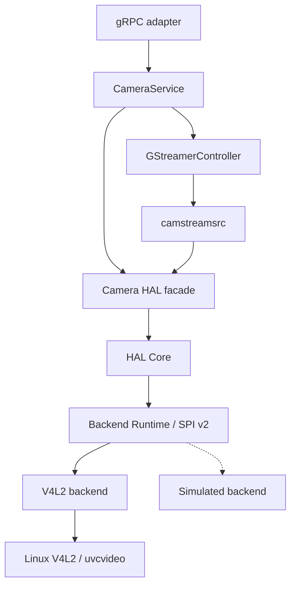

# Component design

RVM has one production path from a V4L2 camera to a GStreamer sender. This guide explains why each implementation boundary exists, what crosses it, and who cleans up. The [public HAL header](../libs/camera-hal/include/camstream/camera/camera_hal.h), [backend SPI header](../libs/camera-hal/include/camstream/camera/camera_backend.h) and [protobuf schema](../apps/grpc-control/proto/camera_control.proto) define callable interfaces. The [system contracts](architecture/system-contracts.md) remain authoritative for ABI and ownership invariants.



The arrows show calls or dependency, not pixel flow. The service and source both use the public HAL, at different times under coordinated serialization. The backend is selected behind SPI v2. Only the V4L2 backend knows Linux camera ioctls. No private HAL or V4L2 structure is part of the gRPC or GStreamer contract.

| Boundary | Call or data that crosses it | Implementation to inspect |
|---|---|---|
| Application/source → HAL | `camstream_camera_*`, opaque camera and versioned structs | [`camera_hal.h`](../libs/camera-hal/include/camstream/camera/camera_hal.h), [`camera_hal.c`](../libs/camera-hal/src/camera_hal.c) |
| HAL Core → backend SPI v2 | Per-instance `camstream_camera_ops_v2` callbacks and backend-private frame tokens | [`camera_backend.h`](../libs/camera-hal/include/camstream/camera/camera_backend.h), [`camera_core.c`](../libs/camera-hal/src/camera_core.c) |
| V4L2 backend → Linux kernel | FD, `VIDIOC_*`, `poll`, MMAP buffer indexes | [`v4l2_device.c`](../backends/camera/v4l2/src/v4l2_device.c), [`v4l2_stream.c`](../backends/camera/v4l2/src/v4l2_stream.c) |

The table identifies interfaces, not a second ownership chain: the service owns the HAL camera, Core owns its public-token records, and the selected backend owns the FD and mapped payload.

## Camera HAL: public facade and private Core

The [HAL facade](../libs/camera-hal/src/camera_hal.c) exports `camstream_camera_*` functions and forwards them to the appropriate owner. It exists so applications have a stable C ABI without seeing private camera state. [`camera_hal.h`](../libs/camera-hal/include/camstream/camera/camera_hal.h) exposes an opaque `camstream_camera*`, C-compatible status values, and structures with `abi_version`/`struct_size` headers. The caller initializes those headers before exchanging data; the private `struct camstream_camera` is never installed as a public type.

[`camera_core.c`](../libs/camera-hal/src/camera_core.c) owns that private structure. Its state tracks Created, Open, Configured, Started and Stopped. It validates calls before dispatching a callback, stores instance diagnostics, and rolls back partial work. A failed operation returns a HAL status; callers can copy the last error separately. The facade does not repeat Core state checks or perform V4L2 I/O.

Core also owns the **public frame-token map**. When `camera_core_acquire_frame()` receives a backend frame, it validates its metadata, obtains a nonzero process-lifetime public token and records the mapping to the backend-private token. `camera_core_release_frame()` finds the mapping for that camera, calls the backend's release callback, and removes the mapping **only after success**. A wrong-camera, zero, stale or duplicate public token cannot release another buffer. If validation or allocation fails after backend acquisition, Core attempts backend release; a failed rollback retains pending ownership or faults the instance. The token allocator is not reset when an instance or module is destroyed.

One HAL instance is **caller-serialized**. The runtime registry mutex does not protect `camera_core_wait_frame()`, acquire, release, stop and destroy from concurrent callers. The application and source must coordinate those operations; see [runtime lifecycle](runtime-lifecycle.md#stop-restart-and-ownership-release).

## Backend Runtime and SPI v2

The [Backend Runtime](../libs/camera-hal/src/camera_backend_runtime.c) is process-wide module state. `camstream_camera_hal_load_backend()` accepts an explicit module path and uses `dlopen(RTLD_NOW | RTLD_LOCAL)`. The module's ELF constructor calls `camstream_camera_hal_get_binding_slot_v2()` and writes callback addresses into HAL-owned staging storage. The runtime checks the calling loader thread, one claim per load, exact binding/operation sizes, SPI version, name and required callbacks before copying a complete binding into its active table. A v1 module cannot be treated as v2. This is a backend-only SPI change; the application-facing HAL ABI remains v1.

The [V4L2 constructor](../backends/camera/v4l2/src/camera_backend_v4l2.c) illustrates the boundary: its operation table assigns `camera_acquire_frame = v4l2_acquire_frame` and `camera_release_frame = v4l2_release_frame`, then publishes metadata/version. It performs **no device I/O**. Core calls the table; the backend implementation decides how to satisfy the operation. This C function-pointer table provides implementation choice without a second C++ camera hierarchy.

For one frame, [`camstream_src_create()`](../plugins/camstreamsrc/src/camstreamsrc.c) calls the public `camstream_camera_acquire_frame(camera, &frame)`. The [facade](../libs/camera-hal/src/camera_hal.c) forwards it to Core, where the actual dispatch is:

```c
/* Extract from camera_core_acquire_frame(); camera and acquired are local values. */
const camstream_camera_status_t status =
        camera->binding->control_funcs->camera_acquire_frame(camera->instance, &acquired);
```

The [V4L2 constructor](../backends/camera/v4l2/src/camera_backend_v4l2.c) bound that callback to `v4l2_acquire_frame()`. The backend performs `VIDIOC_DQBUF` and returns a **private token** with a temporary view of its MMAP bytes. Core validates the result, records private → public token mapping and returns a **public token** to the source. The reverse call, `camstream_camera_release_frame(camera, public_token)`, makes Core look up the private token and invoke `v4l2_release_frame()`, whose successful `VIDIOC_QBUF` returns the slot to the driver. Neither the public ABI nor the source sees a V4L2 index. For exact time ordering, see [one frame in the runtime guide](runtime-lifecycle.md#one-frame-three-ownership-domains).

Runtime client references and create reservations prevent use of unloaded callback addresses. It reserves a create transaction under its mutex, invokes backend create outside the mutex, then converts the reservation to a live instance or destroys a partial instance before canceling. A nonfinal client-reference release may succeed while an instance lives; a final release cannot unload with a live instance or create reservation. `dlopen`, `dlclose` and backend callbacks run **outside** the runtime mutex because a constructor or destructor can re-enter the runtime. If final `dlclose` fails, the runtime records Faulted rather than claiming successful unload. The service destroys its camera before releasing its module reference.

## V4L2 backend and simulated backend

The [V4L2 backend implementation](../backends/camera/v4l2/src/v4l2_internal.h) has one private `camstream_camera_instance` per camera. [`v4l2_device.c`](../backends/camera/v4l2/src/v4l2_device.c) creates/destroys it, owns the FD/open/close boundary, checks `VIDIOC_QUERYCAP`, and supplies syscall wrappers used by fake-I/O tests. It captures `errno` at failure sites. Device close can retain diagnostic cleanup warnings while resetting FD ownership after Linux close semantics; a warning is not proof that a frame was delivered.

[`v4l2_config.c`](../backends/camera/v4l2/src/v4l2_config.c) enumerates `VIDIOC_ENUM_FMT`, frame sizes and intervals, validates a requested YUYV mode, then negotiates format and frame interval with `S_FMT`, `S_PARM` and `G_PARM`. `requested` is the client's target; `active` is the driver-confirmed result. It checks the active pixel format, dimensions, stride/image size and rational interval before publishing a configured state. A failure after `S_FMT` uses the backend's rollback/close-and-reopen policy rather than returning a false active mode.

[`v4l2_stream.c`](../backends/camera/v4l2/src/v4l2_stream.c) owns buffer allocation and streaming: `REQBUFS`, `QUERYBUF`, `mmap`, initial `QBUF`, `STREAMON`, bounded `poll`, `DQBUF`, release `QBUF`, `STREAMOFF` and unmapping. The kernel controls queue availability; the backend owns mapped addresses and tracks which buffer is queued or outstanding. A backend-private token identifies a dequeued buffer until release. A `V4L2_BUF_FLAG_ERROR` frame is warned about, discarded and requeued; a failed requeue remains an error. Partial mapping or queue failure follows the same owner back through checked cleanup. A NULL `mmap` address is rejected during Configure because HAL v1 cannot publish a NULL plane pointer, even though only `MAP_FAILED` means an OS mmap failure.

The [simulated backend](../backends/camera/simulated/src/camera_backend_simulated.c) uses the same SPI callbacks and per-instance token/buffer state but no physical device. Its predictable YUYV frames and controllable failure cases let host tests exercise HAL, source and service ownership. It substitutes for V4L2 in a test session; it is not a second production acquisition path and is not installed in the R3 runtime image.

## GStreamer source plugin

[`camstreamsrc`](../plugins/camstreamsrc/src/camstreamsrc.c) is a C/GObject `GstPushSrc`. Its public [bind API](../plugins/camstreamsrc/include/camstream/gst/camstreamsrc.h) receives a **borrowed** HAL handle and a driver-confirmed active mode; the plugin neither creates the camera nor loads a backend. It checks that active YUYV dimensions and FPS are representable as GStreamer caps, mapping YUYV to `video/x-raw,format=YUY2`. `get_caps`/`set_caps` expose the data it can actually emit, not every camera-advertised format.

`camstream_src_create()` performs bounded HAL wait/acquire, validates the plane, stride, size and active mode, then copies each YUYV row into independently owned `GstBuffer` memory. It releases the public HAL token successfully **before** assigning the output buffer to GStreamer. Source PTS approximates pipeline running time near acquisition, nominal duration comes from active FPS, and `DISCONT` marks the first frame or a sequence gap. If allocation, frame validation or HAL release fails, it publishes no normal frame. A failed release leaves a pending token for `camstream_src_retry_pending_release()` after the pipeline quiesces. `unlock`/`unlock_stop` signal flushing; they do not destroy HAL state or race an in-flight acquire.

## GStreamerController and CameraService

[`GStreamerController`](../libs/gstreamer-controller/src/gstreamer_controller.cpp) owns pipeline, bus, element/pad references and the media destination selected at server startup. `accepts()` validates active YUYV, even width, positive representable FPS and image size before Service commits Configured. RTP/JPEG mode additionally requires dimensions divisible by eight and at most 2040. `start()` loads the plugin, binds the borrowed camera and assembles either `camstreamsrc ! fakesink` (local) or `camstreamsrc ! queue ! jpegenc ! rtpjpegpay ! udpsink` (network). The network queue keeps at most two buffers and drops older ones if downstream is slow; the payloader uses payload type 26 and MTU 1200.

Controller `stop()` requests source stop, moves the pipeline to NULL, waits for quiescence, retries a pending token release, unbinds the camera and releases GStreamer references. Failure to quiesce or unbind returns failure **while keeping dependent objects alive**. Its bus handler/poller converts pipeline ERROR/EOS into a service-visible fault. `local_pipeline_frames` counts fakesink handoffs in local mode or complete JPEG buffers before RTP in network mode; it is not an Ubuntu decoded-frame count.

[`CameraService`](../apps/camera-service/src/camera_service.cpp) owns the HAL instance and module client reference from Configure through Stop. Its `operation_mutex_` serializes service Configure, Start, Stop, Discover and Status; the source's in-flight gate coordinates frame callbacks with Stop. `configure_locked()` loads/creates/opens/configures HAL and calls `controller_.accepts()` before committing Configured. `start_locked()` starts HAL before the pipeline. `stop_locked()` quiesces Controller before HAL stop/close/destroy and module unload. If quiescence fails, the Service enters Faulted and retains the camera for a later safe cleanup attempt. Its process-local generation changes with service state; a lost RPC reply does not roll back a committed operation.

## gRPC adapter, server and shared diagnostics

[`server_main.cpp`](../apps/grpc-control/src/server_main.cpp) creates one long-lived Service and a synchronous [adapter](../apps/grpc-control/src/grpc_adapter.cpp). The [protobuf API](../apps/grpc-control/proto/camera_control.proto) defines `ListCameras`, `GetCapabilities`, `GetStatus`, `ConfigureCamera`, `StartStream` and `StopStream`. The adapter validates logical `camera0`, mode fields and `expected_generation`, calls Service and maps HAL/service results to gRPC statuses. `ListCameras` reports the operator's mapping, not physical discovery. The client queries Status before retrying a lost or timed-out mutating response. RPC carries no frames and cannot redirect the UDP destination; see the [control contract](../apps/grpc-control/README.md).

The [common logger](../libs/common/include/camstream/common/log.h) supplies `CAM_LOGE/W/I/D`. An error may also appear as a HAL status/last-error string, GStreamer flow/bus error and gRPC status; logs alone do not make the operation successful.

## Ownership at a glance

| Resource | Owner while active | Borrower / release boundary |
|---|---|---|
| HAL camera and backend module client reference | CameraService | `camstreamsrc` borrows camera; Service destroys camera before final unload |
| Runtime binding and module handle | Backend Runtime | Core calls callbacks only while runtime reservation/instance protects the module |
| HAL public frame-token map | HAL Core | Source holds a token temporarily; mapping is removed after successful backend release |
| V4L2 FD, MMAP buffers, queue and private token | V4L2 backend instance | HAL frame plane borrows mapped data until release/requeue |
| Pipeline, bus, elements and pads | GStreamerController | Source callback must quiesce before Controller releases references |
| Copied `GstBuffer` | GStreamer reference holders | Downstream may retain the copy after HAL token release |
| gRPC request/response | Adapter/server | No camera or frame ownership transfer to the client |

For example, while the source is copying a frame, `frame.planes[0].data` is a **borrowed** pointer into backend MMAP storage. The newly allocated `GstBuffer` is **owned** by GStreamer and contains a copy. After successful HAL release, the source must stop reading the borrowed pointer; downstream may keep reading the copy. On release failure, the source keeps token cleanup responsibility and publishes no normal buffer.
