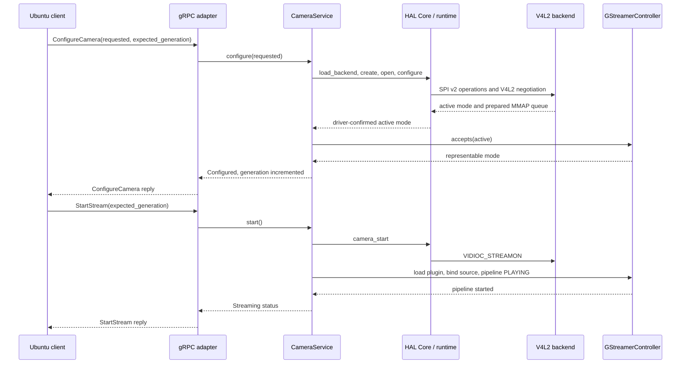
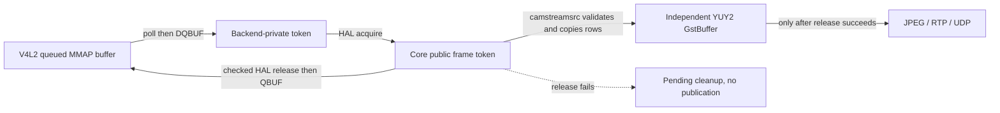
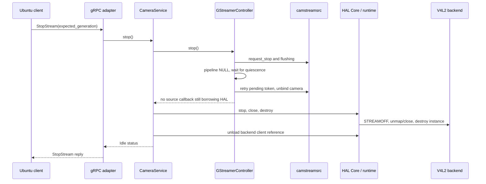
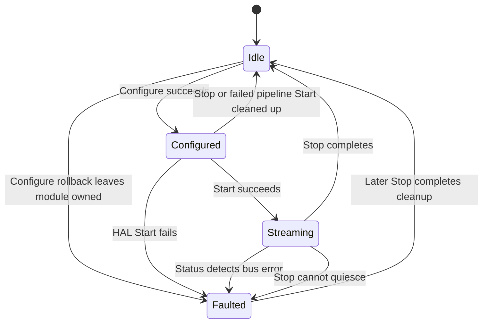

# Runtime lifecycle

This guide follows one camera session from server startup through Stop. The [component design](component-design.md) explains the modules; the [system contracts](architecture/system-contracts.md) define protected ABI and ownership rules. A **service state** (Idle/Configured/Streaming/Faulted) is different from the HAL Core's private device states and from GStreamer's NULL/READY/PAUSED/PLAYING states.

## Startup and capability discovery

The [BBB init script](../br2-external/package/remote-video-monitoring/S90remote-video-monitoring) reads `/etc/default/remote-video-monitoring` and launches [`camstream-grpc-server`](../apps/grpc-control/src/server_main.cpp) with explicit backend, plugin and source paths. The server creates one long-lived `CameraService` and a synchronous gRPC adapter. Its default listener is loopback and its default media mode is local `fakesink`; a trusted-lab operator must opt in to network mode and a specific listener address.

`ListCameras` returns the server's logical `camera0` mapping, not a USB scan. `GetCapabilities` calls [`CameraService::discover()`](../apps/camera-service/src/camera_service.cpp) while Idle. Discover temporarily loads/creates/opens HAL, queries a bounded list of backend modes, then closes/destroys/unloads before returning. A successful mapping response is therefore weaker than a successful capability query, and an advertised mode is still not proof of delivered frames.

## Configure and Start

The adapter validates the camera ID, positive YUYV dimensions/rational FPS and required `expected_generation` before calling Service. [`CameraService::configure_locked()`](../apps/camera-service/src/camera_service.cpp) loads the backend module, creates an opaque HAL camera, opens the source, and calls HAL Configure. [`v4l2_configure()`](../backends/camera/v4l2/src/v4l2_config.c) negotiates `S_FMT` and a confirmed frame interval, then asks [`v4l2_allocate_buffers()`](../backends/camera/v4l2/src/v4l2_stream.c) to prepare the MMAP queue. The driver can adjust the request: Service stores `requested` separately from `active`. Controller `accepts()` checks the active mode before Service commits Configured; network RTP/JPEG has extra dimension constraints.

[`CameraService::start_locked()`](../apps/camera-service/src/camera_service.cpp) starts HAL first, then the controller. The controller loads the plugin, binds the borrowed camera and starts either local `camstreamsrc ! fakesink` or network `camstreamsrc ! queue ! jpegenc ! rtpjpegpay ! udpsink`. A successful Start means this BBB pipeline reached its required local state; it does **not** acknowledge a received UDP packet or decoded Ubuntu frame.

## One frame: three ownership domains

The V4L2 backend owns the FD, mapped addresses and queued/outstanding buffer state. `v4l2_wait_frame()` uses bounded `poll`; `v4l2_acquire_frame()` calls `VIDIOC_DQBUF`, validates index and payload bounds, and returns an instance-private token. A frame marked `V4L2_BUF_FLAG_ERROR` is discarded and requeued when possible; failure of that `QBUF` is reported. [`camera_core_acquire_frame()`](../libs/camera-hal/src/camera_core.c) validates the backend frame, allocates a process-unique public token and records the private-token mapping. Core rejects zero, stale or wrong-camera tokens.

[`camstream_src_create()`](../plugins/camstreamsrc/src/camstreamsrc.c) calls public HAL wait/acquire, validates plane pointer, stride, size and active YUYV mode, then allocates a GStreamer-owned buffer and copies image rows into tightly packed YUY2 data. It calls HAL release **before** assigning the output buffer to GStreamer. HAL release reaches `camera_core_release_frame()`, which removes its mapping only after backend `QBUF` succeeds. The plugin may publish the copied buffer afterward, so JPEG encoding never reads a requeued MMAP address. If release fails, the plugin keeps a pending token and returns an error with no normal buffer.

PTS is estimated from pipeline running time near acquisition. Duration is nominal from the confirmed active frame interval; `DISCONT` marks a first frame or sequence gap. Neither value proves camera exposure time or network arrival. Network `local_pipeline_frames` observes encoded JPEG buffers before RTP packetization. An Ubuntu receiver must measure decoded frames, caps and timing separately.

## Stop, restart and ownership release

[`GStreamerController::stop()`](../libs/gstreamer-controller/src/gstreamer_controller.cpp) closes new source admission, requests flushing, moves the pipeline to NULL and waits for completion. A bounded HAL wait allows an in-flight `create` to return; it must finish any acquired frame release or retain an explicit pending token. Only after quiescence does Controller retry a pending release, unbind source and release pipeline/bus references. [`CameraService::stop_locked()`](../apps/camera-service/src/camera_service.cpp) then performs state-valid HAL stop/close/destroy and releases its backend client reference. HAL destroy precedes final `dlclose` because the callback table belongs to that module.

After Stop reaches Idle, the gRPC server stays alive. A new Start requires another Configure. The source's copied `GstBuffer` may still be referenced downstream after HAL release, but it no longer borrows backend MMAP memory. If quiescence fails, Controller returns failure and Service retains the HAL camera in Faulted rather than freeing memory under a callback. A later Stop may attempt cleanup again. A destructor may abort if it cannot end active borrowing safely; that is not a clean-shutdown result.

## Failure paths and status

The diagram shows **service states**, not every HAL or GStreamer substate. On a Configure failure, Service calls `stop_locked()` to undo acquired resources; if final unload cannot complete, it keeps Faulted ownership. A HAL Start failure enters Faulted. If pipeline Start fails after HAL Start, Service attempts Stop and returns the pipeline error; cleanup may reach Idle or retain a faulted resource. A failed frame release never becomes a successful published frame. If pipeline NULL or source unbind fails, Stop cannot destroy HAL safely.

[`CameraService::status()`](../apps/camera-service/src/camera_service.cpp) is also a state transition point: while Streaming, it calls `controller_.poll_bus()`; a GStreamer ERROR/EOS fault changes Service to Faulted and increments generation. Thus a Start reply and even a previous Status result cannot guarantee that the stream remains healthy. The next client request must use current Status/generation. A gRPC timeout or lost reply after a committed operation does not undo that operation; query GetStatus before retrying. Generation is process-local and restarts from zero when the server restarts.

| Failure point | Owner action | Observable result |
|---|---|---|
| Backend load/bind, create or open fails | Runtime/Core unwind reservation or partial instance; Service attempts cleanup | HAL/service error, no false Configured |
| Mode or MMAP preparation fails | V4L2 preserves error and rolls back mapped/queued resources; Service cleans camera | No active mode published |
| HAL frame validation or release fails | Core keeps pending mapping/fault; source suppresses output | Flow/bus error; cleanup retry required |
| GStreamer element, state or bus failure | Controller reports fault; Service cleanup or Status transition | Faulted or cleaned Idle with an error |
| Stop cannot quiesce callback | Controller retains dependent references; Service retains HAL/module | Faulted; destroy/unload postponed |
| UDP receiver absent | Sender may continue locally because UDP lacks acknowledgement | BBB Start can succeed; receiver delivery unverified |

The service operation mutex serializes control RPCs, while source capture uses its own in-flight gate. Both must honor the HAL's caller-serialization contract. The runtime mutex protects module transitions and is **not** held across backend callbacks, loader calls or blocking frame work.
