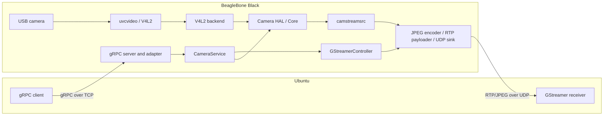
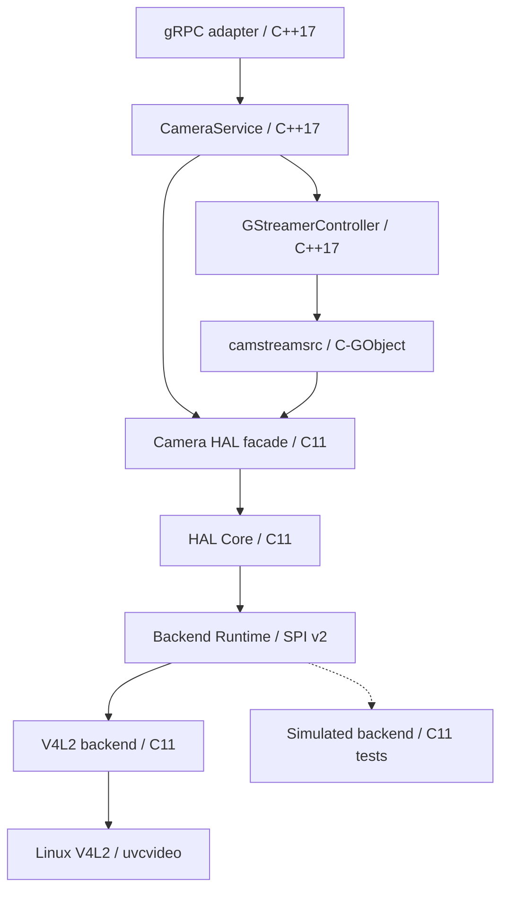

# System architecture

RVM captures one USB UVC camera on a BeagleBone Black (BBB), controls it from Ubuntu, and sends video to an Ubuntu receiver. The BBB runs Linux and a Buildroot root filesystem. The control and video paths are separate.

The practical problem is to operate a camera on a headless board without putting device-specific `ioctl` code in the remote client or sending raw frames through control RPCs. RVM supports one configured camera session and one operator-selected UDP receiver. It is a lab system: the current network transports have no authentication or delivery guarantee.

## Hardware and deployment

The camera plugs into BBB USB. The Linux `uvcvideo` kernel driver presents a V4L2 capture device such as `/dev/videoX`; the exact node is checked on the board because a UVC device can also expose a metadata node. Buildroot supplies the kernel, root filesystem, shared libraries, plugin and SysV service. Ubuntu runs a separate gRPC client and GStreamer receiver. The client and receiver are separate processes; stopping a camera session does not terminate the BBB server.

## Software dependency direction

This diagram shows **calls and dependencies**, not the direction in which pixels flow. The top-level server accepts an RPC and delegates to the service. The service owns the camera and coordinates the controller. The controller can call the source's binding API, but the source obtains frames only through the public HAL. Core dispatches backend operations through SPI v2. Only the V4L2 backend calls Linux device APIs. The simulated backend implements the same SPI for host tests and does not open a second production camera.

Each boundary hides a different kind of change. The HAL prevents service and plugin code from depending on `VIDIOC_*` details. The backend SPI allows a simulated implementation to exercise ownership and errors without a camera. GStreamer turns acquired frames into timed buffers and manages media elements; it does not decide who owns the camera. gRPC gives remote clients a typed control contract, but it does not manage capture buffers. These separations let a device failure remain a backend/HAL status while a pipeline failure remains a GStreamer/service status.

## Two paths, one camera owner

The **control plane** uses [`camstream.control.v1`](../apps/grpc-control/proto/camera_control.proto). The server adapter checks requests and calls one long-lived `CameraService`. The service owns the HAL camera and backend module reference. The controller owns GStreamer pipeline state. No RPC carries frame payload or changes the media destination; the operator chooses the destination when starting the server.

A Configure RPC carries a requested YUYV width, height and rational frame rate plus the expected service generation. The adapter validates the request; the service asks HAL and V4L2 for the driver-confirmed active mode, then asks the controller whether that mode can feed the chosen pipeline. A successful Start reports the BBB pipeline state. Status may expose a later bus fault. A timeout after a committed RPC is resolved by querying Status, not by assuming the operation was undone. The single logical ID `camera0` is a server mapping, not proof of a physically present camera.

The **video path** is Linux `uvcvideo` → V4L2 userspace backend → Camera HAL → `camstreamsrc` → GStreamer. The source borrows the HAL instance, copies each accepted YUYV frame into a GStreamer-owned YUY2 buffer, and releases its HAL token before the buffer reaches downstream elements. Network mode adds a bounded queue, `jpegenc`, `rtpjpegpay`, and `udpsink`. The Ubuntu receiver uses `udpsrc`, jitter buffer, JPEG depayloader/decoder, and a video sink. Local mode ends at `fakesink` for regression use.

The backend's MMAP storage is reusable only after a successful release/requeue. The independent `GstBuffer` copy allows downstream JPEG encoding to continue after the backend buffer is returned. The queue bounds local backlog and may drop old frames when encoding falls behind. RTP/JPEG packages encoded video for UDP; UDP send success does not prove the Ubuntu process received or decoded it. Receiver frame counts and timestamps therefore have their own observation point.

There is one production capture path. The simulated backend replaces V4L2 in host tests. Tools such as `v4l2-ctl` inspect the device independently; they are not another capture owner in RVM.

## Layer boundaries

| Layer | Language | Responsibility |
|---|---|---|
| Public Camera HAL, Core, runtime | C11 | Stable application ABI, camera state, tokens, module binding and references |
| V4L2 / simulated backend | C11 | Backend SPI v2 callbacks; V4L2 owns FD, MMAP mappings and queue state |
| `camstreamsrc` | C/GObject | HAL-to-GStreamer copy, caps, timestamps and flushing |
| GStreamerController | C++17 | Pipeline, bus, elements, media mode and coordinated teardown |
| CameraService | C++17 | Session state, HAL/module ownership and serialized control operations |
| gRPC adapter/server/client | C++17 | Validated remote control; no video payload |

The runtime loads a backend module with `dlopen`. Its ELF constructor binds callback addresses to a HAL-owned SPI v2 slot without device I/O. The controller loads/registers the GStreamer plugin. Both use private implementation state behind public headers. See [component design](component-design.md), [runtime lifecycle](runtime-lifecycle.md), and the [protected contracts](architecture/system-contracts.md).

The public C HAL boundary is intentionally small: opaque camera handles, versioned data structures and status results cross it; FD values, V4L2 buffer indices, GStreamer objects and C++ classes do not. The service may call HAL for configuration and teardown while the plugin calls HAL for frames, so the controller must quiesce the plugin before service cleanup. A runtime mutex protects module transitions; it does not make simultaneous calls on one camera safe.

## Network contract and limits

The server defaults to `127.0.0.1:50051`, plaintext gRPC, and local media mode. A non-loopback listener requires explicit `--allow-insecure-lan`; use it only on a trusted, isolated lab network. RTP/JPEG uses an operator-selected numeric IPv4 destination and UDP port. UDP has no delivery acknowledgement; a successful Start only establishes the BBB pipeline. Receiver playback and decoded FPS must be measured on Ubuntu. No TLS, authentication, adaptive bitrate, or production recovery policy is implemented.

The current implementation supports YUYV input through HAL, one active session and a network JPEG sender. It does not implement a second direct V4L2 capture path, cloud/Internet access, recording, multi-camera operation, zero-copy DMA-BUF or automatic USB recovery. The [M7 evidence record](verification/m7-verification-report.md) describes the owner's functional BBB result and the performance/stability checks that remain open.
